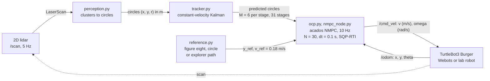

# TurtleBot NMPC: lidar obstacle prediction against Nav2 MPPI

An acados NMPC for a TurtleBot3 that tracks the obstacles seen by its 2D lidar, predicts where they will be over the next 3 s and plans around them. In Webots it avoided a person crossing at 0.5 m/s in 6 of 7 runs, where Nav2's MPPI made contact in 3 of 3; on the lab robot it tracks a 0.5 m circle to 1.0 and 1.9 cm RMS (odometry, 2 runs).

[Simulation results](results/sim_2026-10-30/README.md) · [Real-robot runs](results/real_2026-11-01/README.md) · [Formulation](docs/FORMULATION.md) · [Exploration](docs/EXPLORATION.md)

<p>


</p>

*Left: Webots ground truth, person crossing at 0.5 m/s; the NMPC slows and passes behind, MPPI is hit. Right: the lab TurtleBot3 on a figure eight with the same controller (phone video, 2.5x).*

A personal project started on 30 October 2026, with access to the EECS C106A TurtleBots at UC Berkeley. The question: if the MPC knows where a walking person will be over its horizon, does it avoid them better than MPPI, which only sees the current costmap?

## Overview

Each lidar scan is cut into circles, each circle is tracked by a constant-velocity Kalman filter, and the tracks are predicted to the time of every MPC stage. The NMPC keeps the robot on the path and outside the predicted circles. The baselines are Nav2's MPPI and Regulated Pure Pursuit on the same path, costmap and speed caps. The code is mine except the TurtleBot3 driver configuration, adapted from `webots_ros2_turtlebot`; solver, Nav2, Webots and cartographer are upstream.



*The controller node. With `predict:=false` the tracker gives every obstacle zero velocity: that is the ablation, and what a costmap controller sees.*

## The optimal control problem

Every 0.1 s, from the measured state $`\hat{x}(t)`$, acados solves

```math
\begin{aligned}
\min_{x,\,u,\,s}\quad & \sum_{k=0}^{N-1} \big\lVert y(x_k,u_k) - y^{\mathrm{ref}}_k \big\rVert^2_{W}
\;+\; \big\lVert y_N(x_N) - y^{\mathrm{ref}}_N \big\rVert^2_{W_N}
\;+\; \sum_{k=0}^{N}\sum_{j=1}^{M} \left(\rho_1\, s_{k,j} + \rho_2\, s_{k,j}^2\right) \\[6pt]
\text{s.t.}\quad & x_0 = \hat{x}(t), \qquad x_{k+1} = \Phi_{\mathrm{RK4}}(x_k, u_k, \Delta t) \\[2pt]
& \big\lVert p_k - \hat{o}_j(\tau_{k,j}) \big\rVert \;\ge\; \hat{r}_j(\tau_{k,j}) + r_{\mathrm{robot}} + 0.05\ \mathrm{m} - s_{k,j}, \qquad s_{k,j} \ge 0 \\[2pt]
& 0 \le v_k \le v_{\max}, \quad |\omega_k| \le \omega_{\max}, \quad |a_k| \le a_{\max}, \quad |\alpha_k| \le \alpha_{\max}
\end{aligned}
```

on the unicycle with the velocities as states, so the acceleration limits are hard and the command is smooth:

```math
x = \begin{bmatrix} p_x & p_y & \theta & v & \omega \end{bmatrix}^{\top}, \qquad
u = \begin{bmatrix} a & \alpha \end{bmatrix}^{\top}, \qquad
\dot{p}_x = v\cos\theta,\;\; \dot{p}_y = v\sin\theta,\;\; \dot{\theta} = \omega,\;\; \dot{v} = a,\;\; \dot{\omega} = \alpha
```

The cost tracks $`(p_x, p_y, \cos\theta, \sin\theta, v, \omega, a, \alpha)`$, so there is no angle wrapping. Obstacle $`j`$ is the tracker's circle moved by its estimated velocity to the time of stage $`k`$, with a radius that grows with the velocity uncertainty (at most 0.25 m). Full formulation: [docs/FORMULATION.md](docs/FORMULATION.md).

| | |
|---|---|
| Horizon | $`N = 30`$ stages of $`\Delta t = 0.1`$ s (3 s) |
| Weights | $`W = \mathrm{diag}(20, 20, 2, 2, 5, 0.2, 2, 0.2)`$, $`W_N = \mathrm{diag}(40, 40, 4, 4, 5)`$ |
| Slack penalty | $`\rho_1 = 200`$, $`\rho_2 = 2000`$: the QP stays feasible when someone steps next to the robot |
| Limits (Burger) | $`v_{\max} = 0.20`$ m/s, $`\omega_{\max} = 2.0`$ rad/s, $`a_{\max} = 0.5`$ m/s², $`\alpha_{\max} = 3.0`$ rad/s² |
| Solver | SQP-RTI, Gauss-Newton, HPIPM, $`M = 6`$ obstacles per stage |

A track's velocity is used after 3 detections and above 0.10 m/s. Code: [`ocp.py`](src/tb_nmpc/tb_nmpc/ocp.py), [`tracker.py`](src/tb_nmpc/tb_nmpc/tracker.py).

## Results

### Simulation (Webots)

Same caps for every controller (0.20 m/s, 2.0 rad/s), one lap of a 9.15 m figure eight per run, each in a fresh simulation. Cells: runs with contact / runs, then each run's closest approach in cm (edge to edge, ground truth; negative is contact).

| Scenario | NMPC + prediction | NMPC, no prediction | Nav2 MPPI | Nav2 RPP |
|---|---|---|---|---|
| Person crossing at 0.5 m/s | **1/7**: -2.2 to +32.1, median +12.2 | 2/2: -9.2, -9.0 | 3/3: -21.8, -19.8, -18.2 | 2/2: -7.3, -7.3 |
| Person crossing at 1.0 m/s | 2/2: -8.5, -6.6 | 2/2: -20.5, -18.2 | 2/2: -25.0, -18.5 | 2/2: -15.7, -15.6 |
| Two static obstacles near the path | 0/2: +4.0, +10.2 | 0/2: +4.7, +4.7 | 1/2: -7.1, +5.5 | 2/2: -7.0, -7.0 |
| Clear lap, median of 2: tracking RMSE (odometry), lap time | 0.2 cm, 53.0 s | 0.2 cm, 52.9 s | 8.6 cm, 45.7 s | 2.1 cm, 64.3 s |

The seven NMPC runs at 0.5 m/s: 2 benchmark runs, the video run and 4 repeats on 31 October ([repeats](results/sim_2026-10-31_crossing_repeats/README.md)); 5 runs of an intermediate version with a clock bug are kept apart.


*True paths in the 0.5 m/s crossing. The predictive NMPC turns behind the person; the others hold their line and are hit from the side.*

- At 1.0 m/s every controller is hit: the tracker needs three 5 Hz scans to trust a velocity, which leaves about one second at 0.20 m/s. Prediction reduces the contact depth (-8.5 vs -20.5 cm worst case).
- NMPC solve time: 0.79 to 0.91 ms median per run, worst 11.7 ms, on a 2016 laptop CPU (i7-6700HQ), against a 100 ms period.
- MPPI has no target speed and drives at its cap: it laps fastest and cuts the lobes.

### Lab robot

TurtleBot3 Burger in the C106A lab, ROS 2 Humble, controller on the lab workstation, 0.12 m/s cap. No motion capture: errors are in the odometry frame.

| Runs | Path | Tracking RMSE / max, odometry [cm] |
|---|---|---|
| NMPC, 2 runs | circle r = 0.5 m, 2 laps each | 1.9 / 8.6 and 1.0 / 3.4 |
| NMPC, 1 run | figure eight a = 0.5 m | 6.1 / 11.2 |

Solve time 1.2 to 1.5 ms median, under 3 ms max, on the lab workstation.

The runs with a box on the circle are not a valid comparison yet: both path setups had a bug ([run notes](results/real_2026-11-01/README.md)).

The same controller drives an autonomous frontier exploration with cartographer: run 3 lasted 5 min 30 s, drove 13.9 m, mapped 13.2 m x 8.4 m and took 76 photos ([run 3](results/explore_2026-11-02c/README.md), [method](docs/EXPLORATION.md)).


*Exploration run 3, replayed from its rosbag. The 360 degree panoramas from its photo spins are in the run 3 notes.*

### How I checked it

- 21 unit tests: 13 for perception, tracker and reference ([`tb_nmpc/test`](src/tb_nmpc/test)), 8 for the explorer ([`tb_explore/test`](src/tb_explore/test)).
- [`offline_check.py`](scripts/offline_check.py): NMPC and tracker on a plain unicycle, no ROS. Over 5 runs each, minimum clearance 23.3 to 26.1 cm with prediction and -20.8 to -17.9 cm without, the same ordering as in Webots ([log](results/offline_check_2026-11-03/README.md)).
- Tracker against the Webots ground truth, person at 0.5 m/s: 8 to 16 cm position and 0.06 to 0.11 m/s velocity error (median per run).
- Baselines: Nav2 Jazzy MPPI defaults and default inflation, one costmap for MPPI and RPP; only MPPI's goal-critic thresholds changed, 1.4 to 0.6 m ([`nav2_mppi.yaml`](src/tb_nmpc/config/nav2_mppi.yaml)).

Bugs that changed the numbers while I built it: [docs/DEVELOPMENT_NOTES.md](docs/DEVELOPMENT_NOTES.md).

## Installation

Tested on WSL2 Ubuntu 24.04 with ROS 2 Jazzy, `ros-jazzy-webots-ros2`, Webots R2025a on Windows, acados v0.5.5 in `~/acados` and casadi 3.7.2, on an i7-6700HQ laptop. The real-robot runs used ROS 2 Humble on the C106A workstation. For the baselines, Nav2:

```bash
sudo apt install ros-jazzy-nav2-controller ros-jazzy-nav2-mppi-controller ros-jazzy-nav2-regulated-pure-pursuit-controller ros-jazzy-nav2-costmap-2d ros-jazzy-nav2-lifecycle-manager
# or, without sudo:
bash scripts/install_nav2_userspace.sh
bash scripts/setup_ws.sh       # ~/tb_ws, links src/ and casadi, builds
source scripts/env.sh
```

The Windows firewall must let WSL reach Webots on TCP 1234.

## Usage

```bash
python3 -m pytest src/tb_nmpc/test src/tb_explore/test   # 21 passed
python3 scripts/offline_check.py                         # about 10 s, min clearance near +24 cm
python3 scripts/offline_check.py --no-predict            # min clearance near -20 cm (contact)
bash scripts/sim.sh controller:=nmpc scenario:=crossing  # then: ros2 service call /tb_nmpc/start std_srvs/srv/Trigger
```

Controllers: `nmpc`, `nmpc_nopred`, `mppi`, `rpp`. Scenarios: `clear`, `static`, `crossing`, `crossing_fast`. Real robot: [docs/REAL_ROBOT_CHECKLIST.md](docs/REAL_ROBOT_CHECKLIST.md).

## Reproducing the results and figures

| Output | Command |
|---|---|
| `results/sim_2026-10-30/` (32 runs) | `bash scripts/run_benchmark.sh results/sim_2026-10-30` (about 80 min) |
| `summary.md` from existing logs | `python3 scripts/metrics.py results/sim_2026-10-30` |
| `docs/figures/paths_*.png`, `clearance_*.png` | `python3 scripts/plot_benchmark.py results/sim_2026-10-30 docs/figures` |
| real-robot circle table | `python3 scripts/metrics_real.py results/real_2026-11-01 --path-shape circle --path-size 0.5` |
| exploration animation | `python3 scripts/bag_animation.py <decompressed bag> docs/figures/real_exploration_run3.gif` |

## Code structure

| Component | File | Role |
|---|---|---|
| OCP | [`ocp.py`](src/tb_nmpc/tb_nmpc/ocp.py) | the problem above, in acados |
| Perception | [`perception.py`](src/tb_nmpc/tb_nmpc/perception.py) | /scan to circles; walls cut into static pieces |
| Tracker | [`tracker.py`](src/tb_nmpc/tb_nmpc/tracker.py) | Kalman tracks and their prediction over the horizon |
| Reference | [`reference.py`](src/tb_nmpc/tb_nmpc/reference.py) | paths, arc-length projection, horizon sampling |
| Node | [`nmpc_node.py`](src/tb_nmpc/tb_nmpc/nmpc_node.py), [`config/`](src/tb_nmpc/config) | ROS 2 node, watchdog, safety stop; Burger and TurtleBot4 limits |
| Baselines | [`nav2_follow.py`](src/tb_nmpc/tb_nmpc/nav2_follow.py), [`nav2_mppi.yaml`](src/tb_nmpc/config/nav2_mppi.yaml), [`nav2_rpp.yaml`](src/tb_nmpc/config/nav2_rpp.yaml) | Nav2 controller_server on the same path |
| Simulation | [`tb_nmpc_sim`](src/tb_nmpc_sim) | Webots worlds, supervisor that walks the pedestrian |
| Exploration | [`tb_explore`](src/tb_explore) | frontier exploration with photo capture |
| Scripts | [`scripts/`](scripts) | benchmark, metrics, figures, panoramas, offline check |

## Limitations

- The contact rates come from simulation, with 2 to 7 runs per cell. On the real robot only tracking is measured so far.
- The simulated person is a 0.15 m cylinder walking straight at constant speed, and does not yield.
- At 1.0 m/s nobody avoids the person, the NMPC included: 5 Hz lidar, three scans to confirm a velocity, 0.20 m/s top speed.
- Nav2 runs without a planner or velocity smoother, with default MPPI parameters.
- No ground truth on the real robot: errors are in the odometry frame.

## Credits and license

- [acados](https://github.com/acados/acados) (BSD-2) and [CasADi](https://web.casadi.org) (LGPL) for the solver.
- [Nav2](https://github.com/ros-navigation/navigation2) (Apache-2.0): MPPI, Regulated Pure Pursuit, costmap.
- [webots_ros2](https://github.com/cyberbotics/webots_ros2) (Apache-2.0): the TurtleBot3 driver configuration is adapted from `webots_ros2_turtlebot`; the robot model is Cyberbotics' TurtleBot3Burger PROTO.
- [cartographer](https://github.com/cartographer-project/cartographer_ros) for the map; the C106A staff for the lab TurtleBots. The photo reconstructions in the exploration notes use my C106A team's Lab 6 code, not in this repository.
- Related work read before starting: G. Turrisi's acados NMPC for a differential-drive robot in ROS 2; MPC with control barrier functions on TurtleBots with moving obstacles (simulation).

MIT license ([LICENSE](LICENSE)). Citation metadata: [CITATION.cff](CITATION.cff).
