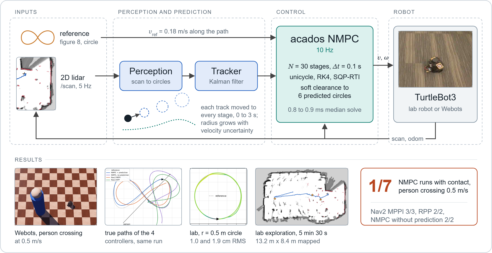

# TurtleBot NMPC: lidar obstacle prediction against Nav2 MPPI

[Simulation results](results/sim_2026-10-30/README.md) · [Real-robot runs](results/real_2026-11-01/README.md) · [Formulation](docs/FORMULATION.md) · [Exploration](docs/EXPLORATION.md) · [Checks and reproduction](docs/REPRODUCING.md)

<p>


</p>

*Left: Webots ground truth, person crossing at 0.5 m/s; the NMPC slows and passes behind, MPPI is hit. Right: the lab TurtleBot3 on a figure eight with the same controller (phone video, 2.5x).*

An acados NMPC for a TurtleBot3 that tracks the obstacles seen by its 2D lidar, predicts where they will be over the next 3 s and plans around them. In Webots it avoided a person crossing at 0.5 m/s in 6 of 7 runs, where Nav2's MPPI made contact in 3 of 3. On the lab robot it tracks a 0.5 m circle to 1.0 and 1.9 cm RMS (odometry, 2 runs) and drives a 5 min 30 s autonomous exploration.



A personal project started on 30 October 2026, with access to the EECS C106A TurtleBots at UC Berkeley. The question: if the MPC knows where a walking person will be over its horizon, does it avoid them better than MPPI, which only sees the current costmap?

## Method

Each lidar scan is cut into circles, each circle is tracked by a constant-velocity Kalman filter, and the tracks are predicted to the time of every MPC stage. Every 0.1 s, from the measured state $`\hat{x}(t)`$, acados solves

```math
\begin{aligned}
\min_{x,\,u,\,s}\quad & \sum_{k=0}^{N-1} \big\lVert y(x_k,u_k) - y^{\mathrm{ref}}_k \big\rVert^2_{W}
\;+\; \big\lVert y_N(x_N) - y^{\mathrm{ref}}_N \big\rVert^2_{W_N}
\;+\; \sum_{k=0}^{N}\sum_{j=1}^{M} \left(\rho_1\, s_{k,j} + \rho_2\, s_{k,j}^2\right) \\[6pt]
\text{s.t.}\quad & x_0 = \hat{x}(t), \qquad x_{k+1} = \Phi_{\mathrm{RK4}}(x_k, u_k, \Delta t) \\[2pt]
& \big\lVert p_k - \hat{o}_j(\tau_{k,j}) \big\rVert \;\ge\; \hat{r}_j(\tau_{k,j}) + r_{\mathrm{robot}} + 0.05\ \mathrm{m} - s_{k,j}, \qquad s_{k,j} \ge 0 \\[2pt]
& 0 \le v_k \le v_{\max}, \quad |\omega_k| \le \omega_{\max}, \quad |a_k| \le a_{\max}, \quad |\alpha_k| \le \alpha_{\max}
\end{aligned}
```

on a unicycle with $`v, \omega`$ as states and accelerations as inputs, $`N = 30`$, $`\Delta t = 0.1`$ s, $`M = 6`$ obstacles per stage, SQP-RTI. Obstacle $`j`$ is the tracker's circle moved by its estimated velocity to the time of stage $`k`$, with a radius that grows with the velocity uncertainty. With `predict:=false` every obstacle gets zero velocity: that is the ablation, and what a costmap controller sees. Weights, limits and the prediction model: [docs/FORMULATION.md](docs/FORMULATION.md).

The baselines are Nav2's MPPI and Regulated Pure Pursuit on the same path, costmap and speed caps. The code is mine except the TurtleBot3 driver configuration, adapted from `webots_ros2_turtlebot`.

## Results

Webots, same caps for every controller (0.20 m/s, 2.0 rad/s), one lap of a 9.15 m figure eight per run, each in a fresh simulation. Cells: runs with contact / runs, then closest approach in cm (edge to edge, ground truth; negative is contact).

| Scenario | NMPC + prediction | NMPC, no prediction | Nav2 MPPI | Nav2 RPP |
|---|---|---|---|---|
| Person crossing at 0.5 m/s | **1/7**: -2.2 to +32.1, median +12.2 | 2/2: -9.2, -9.0 | 3/3: -21.8, -19.8, -18.2 | 2/2: -7.3, -7.3 |
| Person crossing at 1.0 m/s | 2/2: -8.5, -6.6 | 2/2: -20.5, -18.2 | 2/2: -25.0, -18.5 | 2/2: -15.7, -15.6 |
| Two static obstacles near the path | 0/2: +4.0, +10.2 | 0/2: +4.7, +4.7 | 1/2: -7.1, +5.5 | 2/2: -7.0, -7.0 |
| Clear lap: tracking RMSE (odometry), lap time | 0.2 cm, 53.0 s | 0.2 cm, 52.9 s | 8.6 cm, 45.7 s | 2.1 cm, 64.3 s |

At 1.0 m/s every controller is hit: the tracker needs three 5 Hz scans to trust a velocity, which leaves about one second at 0.20 m/s. The NMPC solves in 0.8 to 0.9 ms median on a 2016 laptop CPU.

On the lab TurtleBot3 Burger (ROS 2 Humble, 0.12 m/s cap, no motion capture): circle r = 0.5 m, 1.9 / 8.6 and 1.0 / 3.4 cm RMSE / max over 2 runs; figure eight, 6.1 / 11.2 cm. The same controller drives a frontier exploration with cartographer: run 3 lasted 5 min 30 s, drove 13.9 m, mapped 13.2 m x 8.4 m and took 76 photos ([run 3](results/explore_2026-11-02c/README.md)).


*Exploration run 3, replayed from its rosbag.*

## Install and quick start

Tested on WSL2 Ubuntu 24.04, ROS 2 Jazzy, Webots R2025a on Windows, acados v0.5.5 in `~/acados`, casadi 3.7.2. The lab runs used ROS 2 Humble.

```bash
bash scripts/install_nav2_userspace.sh   # or apt install the ros-jazzy-nav2-* controllers
bash scripts/setup_ws.sh                 # ~/tb_ws, links src/ and casadi, builds
source scripts/env.sh
python3 -m pytest src/tb_nmpc/test src/tb_explore/test   # 21 passed
python3 scripts/offline_check.py                         # no ROS, ~10 s, min clearance near +24 cm
bash scripts/sim.sh controller:=nmpc scenario:=crossing  # then: ros2 service call /tb_nmpc/start std_srvs/srv/Trigger
```

Controllers: `nmpc`, `nmpc_nopred`, `mppi`, `rpp`. Scenarios: `clear`, `static`, `crossing`, `crossing_fast`. The Windows firewall must let WSL reach Webots on TCP 1234. Real robot: [docs/REAL_ROBOT_CHECKLIST.md](docs/REAL_ROBOT_CHECKLIST.md). Benchmark and figure commands: [docs/REPRODUCING.md](docs/REPRODUCING.md).

## Code structure

| Path | Role |
|---|---|
| [`ocp.py`](src/tb_nmpc/tb_nmpc/ocp.py) | the OCP above, in acados |
| [`perception.py`](src/tb_nmpc/tb_nmpc/perception.py), [`tracker.py`](src/tb_nmpc/tb_nmpc/tracker.py) | scan to circles; Kalman tracks and their prediction |
| [`nmpc_node.py`](src/tb_nmpc/tb_nmpc/nmpc_node.py), [`reference.py`](src/tb_nmpc/tb_nmpc/reference.py) | ROS 2 node, watchdog, safety stop; paths and horizon sampling |
| [`nav2_follow.py`](src/tb_nmpc/tb_nmpc/nav2_follow.py), [`config/`](src/tb_nmpc/config) | Nav2 baselines on the same path; robot limits |
| [`tb_nmpc_sim`](src/tb_nmpc_sim), [`tb_explore`](src/tb_explore) | Webots worlds and pedestrian; frontier exploration |
| [`scripts/`](scripts) | benchmark, metrics, figures, offline check |

## Limitations

- The contact rates come from simulation, with 2 to 7 runs per cell; on the real robot only tracking is measured.
- The simulated person is a 0.15 m cylinder walking straight at constant speed, and does not yield.
- At 1.0 m/s nobody avoids the person: 5 Hz lidar, three scans to confirm a velocity, 0.20 m/s top speed.
- Nav2 runs without a planner or velocity smoother, with default MPPI parameters.
- No ground truth on the real robot: errors are in the odometry frame.

## Credits and license

[acados](https://github.com/acados/acados) and [CasADi](https://web.casadi.org) for the solver; [Nav2](https://github.com/ros-navigation/navigation2) for MPPI, RPP and the costmap; [webots_ros2](https://github.com/cyberbotics/webots_ros2) for the TurtleBot3 driver configuration and robot model; [cartographer](https://github.com/cartographer-project/cartographer_ros) for the map; the C106A staff for the lab TurtleBots. The photo reconstructions in the exploration notes use my C106A team's Lab 6 code, not in this repository. Related work read before starting: G. Turrisi's acados NMPC for a differential-drive robot in ROS 2, and MPC with control barrier functions on TurtleBots with moving obstacles.

MIT license ([LICENSE](LICENSE)). Citation metadata: [CITATION.cff](CITATION.cff).
