# TurtleBot NMPC with lidar obstacle prediction, against Nav2 MPPI

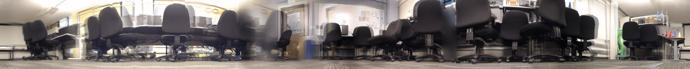

An acados NMPC for a TurtleBot3 that predicts where the obstacles seen by its 2D lidar will be over the next 3 s and plans around them. In Webots it avoided a person crossing at 0.5 m/s in 6 of 7 runs, while Nav2's MPPI made contact in all 3 of its runs. On the lab robot it follows a 0.5 m circle to 1.0 cm and drives an autonomous exploration.

<p>
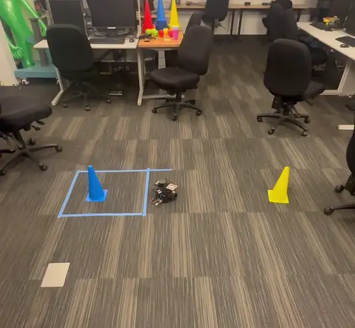
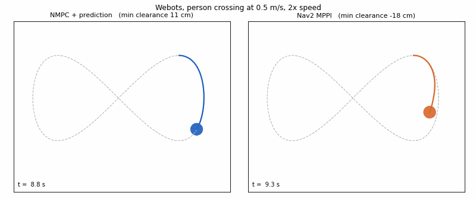
</p>

A personal project started on 30 October 2026, with access to the EECS C106A TurtleBots at UC Berkeley. The question: if the MPC knows where a walking person will be over its horizon, does it avoid them better than MPPI, which only sees the current costmap?

## The optimal control problem

Every 0.1 s, from the measured state $\hat{x}(t)$, acados solves

```math
\begin{aligned}
\min_{x,\,u,\,s}\quad & \sum_{k=0}^{N-1} \big\lVert y(x_k,u_k) - y^{\mathrm{ref}}_k \big\rVert^2_{W}
\;+\; \big\lVert y_N(x_N) - y^{\mathrm{ref}}_N \big\rVert^2_{W_N}
\;+\; \sum_{k=0}^{N}\sum_{j=1}^{M} \left(\rho_1\, s_{k,j} + \rho_2\, s_{k,j}^2\right) \\[6pt]
\text{s.t.}\quad & x_0 = \hat{x}(t), \qquad x_{k+1} = \Phi_{\mathrm{RK4}}(x_k, u_k, \Delta t) \\[2pt]
& \big\lVert p_k - \hat{o}_j(\tau_{k,j}) \big\rVert \;\ge\; \hat{r}_j(\tau_{k,j}) + r_{\mathrm{robot}} + 0.05\ \mathrm{m} - s_{k,j}, \qquad s_{k,j} \ge 0 \\[2pt]
& 0 \le v_k \le v_{\max}, \quad |\omega_k| \le \omega_{\max}, \quad |a_k| \le a_{\max}, \quad |\alpha_k| \le \alpha_{\max}
\end{aligned}
```

on the unicycle with the velocities as states, so the acceleration limits are hard and the command is smooth:

```math
x = \begin{bmatrix} p_x & p_y & \theta & v & \omega \end{bmatrix}^{\top}, \qquad
u = \begin{bmatrix} a & \alpha \end{bmatrix}^{\top}, \qquad
\dot{p}_x = v\cos\theta,\;\; \dot{p}_y = v\sin\theta,\;\; \dot{\theta} = \omega,\;\; \dot{v} = a,\;\; \dot{\omega} = \alpha
```

```math
y(x, u) = \begin{bmatrix} p_x & p_y & \cos\theta & \sin\theta & v & \omega & a & \alpha \end{bmatrix}^{\top}, \qquad
y_N(x) = \begin{bmatrix} p_x & p_y & \cos\theta & \sin\theta & v \end{bmatrix}^{\top}
```

The heading is tracked through $\cos\theta, \sin\theta$, so there is no angle wrapping. Each obstacle $j$ is a lidar cluster tracked by a constant-velocity Kalman filter (position $o_j$, velocity $\hat{v}_j$, velocity uncertainty $\sigma_{v,j}$, last update $t_j$), predicted to the time of stage $k$:

```math
\tau_{k,j} = t - t_j + k\,\Delta t, \qquad
\hat{o}_j(\tau) = o_j + \hat{v}_j\,\tau, \qquad
\hat{r}_j(\tau) = r_j + \min\left(0.25\ \mathrm{m},\ \sigma_{v,j}\,\tau\right)
```

The reference $y^{\mathrm{ref}}_k$ is the path point at arc length $s_k = s_0 + k\,v_{\mathrm{ref}}\Delta t$ from the robot's projection $s_0$, with speed $v_{\mathrm{ref}}$, turn rate $v_{\mathrm{ref}}\,\kappa(s_k)$ and zero accelerations.

| | |
|---|---|
| Horizon | $N = 30$ stages of $\Delta t = 0.1$ s (3 s) |
| Weights | $W = \mathrm{diag}(20, 20, 2, 2, 5, 0.2, 2, 0.2)$, $W_N = \mathrm{diag}(40, 40, 4, 4, 5)$ |
| Obstacles | $M = 6$ per stage, the closest to the last predicted trajectory; walls as static 0.3 m pieces |
| Slack penalty | $\rho_1 = 200$, $\rho_2 = 2000$: the QP stays feasible when someone steps next to the robot |
| Limits (Burger) | $v_{\max} = 0.20$ m/s, $\omega_{\max} = 2.0$ rad/s, $a_{\max} = 0.5$ m/s², $\alpha_{\max} = 3.0$ rad/s² |
| Solver | SQP real-time iteration, Gauss-Newton, HPIPM with partial condensing: 0.85 ms median |

With `predict:=false`, $\hat{v}_j = 0$: the obstacles stay where they are now. That is the ablation, and what a costmap controller like MPPI sees. Code: [`ocp.py`](src/tb_nmpc/tb_nmpc/ocp.py).

## On the real robot

Lab TurtleBot3 Burger "apple", ROS 2 Humble, controller on the lab workstation. Positions come from odometry and cartographer (no motion capture).

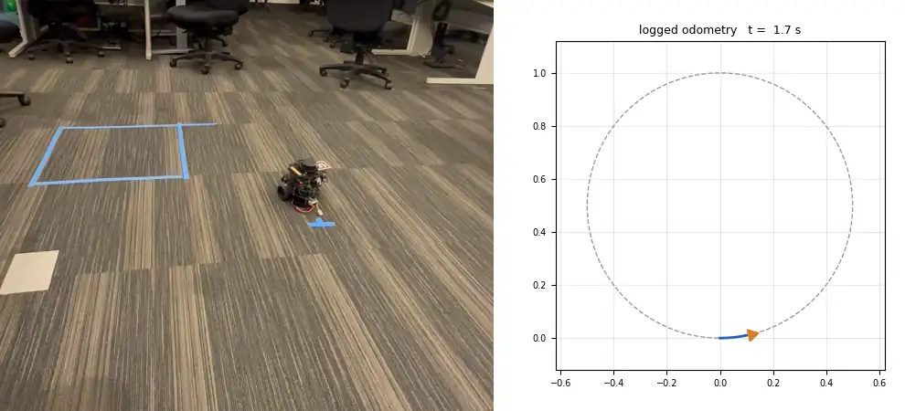

Circle of radius 0.5 m at 0.12 m/s: 1.0 cm RMS tracking error in odometry ([runs](results/real_2026-11-01)).

**Autonomous exploration.** The robot picks a frontier of the cartographer map, the NMPC drives it there, it spins taking 12 photos, and it takes one every 30 cm while driving. Run 3: 5 min 30 s, 13.9 m, a 13.2 m x 8.4 m map, 76 photos. Left, a photo spin (run 1); right, run 3 replayed from its rosbag.

<p>
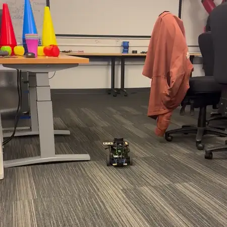
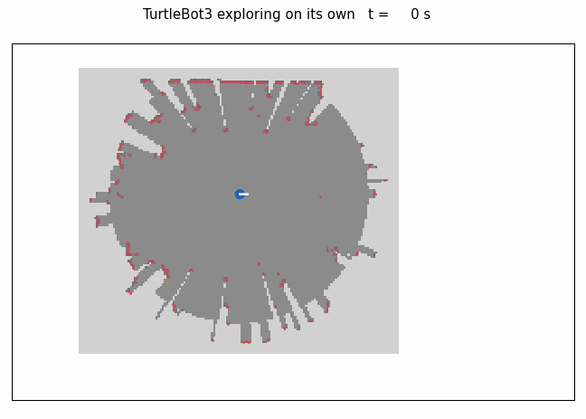
</p>

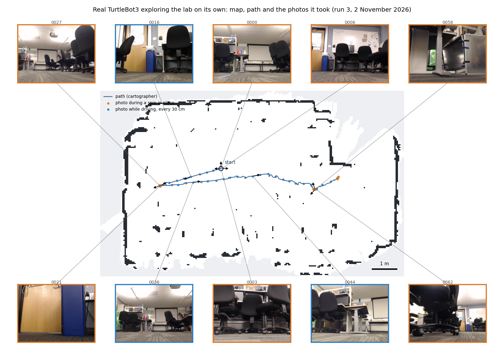

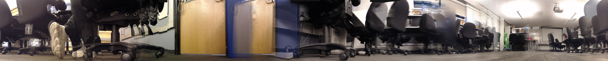

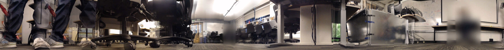

## Results in simulation

Webots, two runs per case (seven for the NMPC at 0.5 m/s), same caps for every controller (0.20 m/s, 2.0 rad/s). Clearance is edge to edge from the ground truth, negative means contact ([summary](results/sim_2026-10-30/summary.md), [repeats](results/sim_2026-10-31_crossing_repeats)).

| | NMPC + prediction | NMPC, no prediction | Nav2 MPPI | Nav2 RPP |
|---|---|---|---|---|
| Person crossing at 0.5 m/s: contact, worst clearance | **1/7, -2.2 cm** (median +12.2) | 2/2, -9.2 cm | 3/3, -21.8 cm | 2/2, -7.3 cm |
| Person crossing at 1.0 m/s | 2/2, -8.5 cm | 2/2, -20.5 cm | 2/2, -25.0 cm | 2/2, -15.7 cm |
| Two static obstacles near the path | 0/2, +4.0 cm | 0/2, +4.7 cm | 1/2, -7.1 cm | 2/2, -7.0 cm |
| Clear lap: tracking RMSE (odometry), lap time | 0.2 cm, 53.0 s | 0.2 cm, 52.9 s | 8.6 cm, 45.7 s | 2.1 cm, 64.3 s |

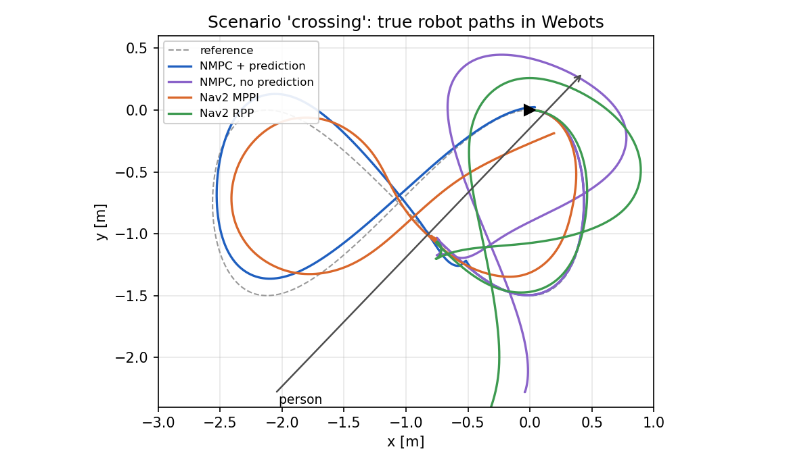

- At 0.5 m/s the predictive NMPC slows and passes behind the person in 6 of 7 runs. Without prediction it is hit from the side, like MPPI and RPP.
- At 1.0 m/s every controller is hit: the tracker needs three 5 Hz scans to trust a velocity, which leaves about one second. Prediction cuts the contact depth from 20.5 to 8.5 cm.
- Solve time 0.79 to 0.91 ms median per run, worst 11.7 ms, on a 2016 laptop CPU (i7-6700HQ), against a 100 ms period.

<details>
<summary>More figures and notes</summary>

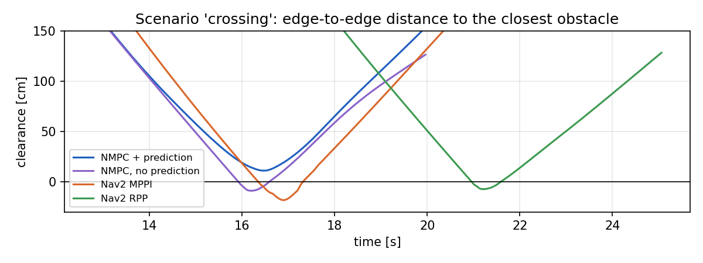

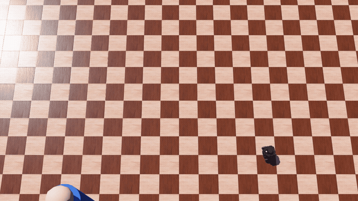

The Webots view is a third NMPC run, recorded separately and not in the table ([log](results/sim_2026-10-30_video/crossing_nmpc_recorded)): 24 cm closest. MPPI has no target speed and drives at its cap, which is part of why it laps fastest and cuts the lobes. RPP has no avoidance and touches both static obstacles.

</details>

## What I built

All of it, except the upstream pieces listed in Credits.

- [`ocp.py`](src/tb_nmpc/tb_nmpc/ocp.py): the problem above in acados.
- [`perception.py`](src/tb_nmpc/tb_nmpc/perception.py): /scan to circles; walls cut into static pieces.
- [`tracker.py`](src/tb_nmpc/tb_nmpc/tracker.py): Kalman tracks and their prediction over the horizon.
- [`nmpc_node.py`](src/tb_nmpc/tb_nmpc/nmpc_node.py): the ROS 2 node, Twist or TwistStamped, [Burger](src/tb_nmpc/config/burger.yaml) and [TurtleBot4](src/tb_nmpc/config/tb4.yaml) limits, safety stop.
- [`nav2_follow.py`](src/tb_nmpc/tb_nmpc/nav2_follow.py): the baselines, Nav2's controller_server with [MPPI](src/tb_nmpc/config/nav2_mppi.yaml) or [RPP](src/tb_nmpc/config/nav2_rpp.yaml) on the same path.
- [`tb_nmpc_sim`](src/tb_nmpc_sim): the Webots world and a supervisor that walks the pedestrian across the path.
- [`tb_explore`](src/tb_explore): frontier exploration with photo capture ([docs](docs/EXPLORATION.md)).
- [`scripts/`](scripts): benchmark, metrics, figures, panoramas, an offline closed-loop check without ROS.

## How I checked it

- 13 unit tests for the controller and 8 for the exploration ([controller](src/tb_nmpc/test), [exploration](src/tb_explore/test)).
- [`offline_check.py`](scripts/offline_check.py): NMPC and tracker in a plain unicycle simulation, no ROS. With prediction 23.5 cm clearance, without it contact (-20.6 cm): the same ordering as in Webots.
- Perception against the Webots ground truth: 8 to 16 cm position and 0.06 to 0.11 m/s velocity error on a person at 0.5 m/s.
- Fair baselines: Nav2 Jazzy MPPI defaults and default inflation, the same costmap for MPPI and RPP. The one change is MPPI's goal-critic thresholds (1.4 to 0.6 m).

<details>
<summary>Things that changed the numbers while I built it</summary>

- The soft obstacle constraints had no penalty on their upper slack. The QP often hit its 50-iteration cap (6 ms median); with the penalty it converges in about 12 iterations (1 ms).
- MPPI first took 100 s for a lap the NMPC does in 53 s. On a figure eight a path segment could end within 1.4 m of the robot, which switches on the goal critics. Segments now end at their farthest point and the thresholds are 0.6 m.
- With the cylinder exactly on the path, both the NMPC and MPPI stopped in front of it for good. I made the NMPC's reference skip past static obstacles, and moved the cylinder 18 cm off the path.
- ros2_control sometimes read the placeholder robot description before the Webots driver replaced it. The placeholder now carries the ros2_control block.
- My first fix for a clock offset between the robot and the computer dropped the scan's transport delay, and contact at 0.5 m/s went to 3 of 5 runs. The offset is now the minimum of (receive time - stamp) over 10 s.

</details>

## Limitations

- The contact rates come from simulation, with few runs. On the real robot only tracking is measured so far: the runs with a box on the circle need redoing.
- The simulated person is a 0.15 m cylinder walking straight at constant speed.
- At 1.0 m/s nobody avoids the person, the NMPC included.
- Nav2 runs without a planner or velocity smoother, with default MPPI parameters.
- No ground truth on the real robot: errors are in the odometry frame.

## Reproduce

WSL2 (Ubuntu 24.04) with ROS 2 Jazzy, `ros-jazzy-webots-ros2`, Webots R2025a on Windows, acados v0.5.5 in `~/acados` and casadi. For the baselines, Nav2:

```bash
sudo apt install ros-jazzy-nav2-controller ros-jazzy-nav2-mppi-controller ros-jazzy-nav2-regulated-pure-pursuit-controller ros-jazzy-nav2-costmap-2d ros-jazzy-nav2-lifecycle-manager
# or, without sudo:
bash scripts/install_nav2_userspace.sh
```

```bash
bash scripts/setup_ws.sh                  # ~/tb_ws, links src/, builds
source scripts/env.sh
python3 scripts/offline_check.py          # NMPC closed loop without ROS, 10 s
python3 -m pytest src/tb_nmpc/test src/tb_explore/test
bash scripts/sim.sh controller:=nmpc scenario:=crossing      # then: ros2 service call /tb_nmpc/start std_srvs/srv/Trigger
bash scripts/run_benchmark.sh results/sim_2026-10-30         # every scenario and controller, about 80 min
python3 scripts/plot_benchmark.py results/sim_2026-10-30 docs/figures
```

The Windows firewall must let WSL reach Webots on TCP 1234. Real robot: [docs/REAL_ROBOT_CHECKLIST.md](docs/REAL_ROBOT_CHECKLIST.md). Exploration: [docs/EXPLORATION.md](docs/EXPLORATION.md).

## Credits

- [acados](https://github.com/acados/acados) (BSD-2) and [CasADi](https://web.casadi.org) (LGPL) for the solver.
- [Nav2](https://github.com/ros-navigation/navigation2) (Apache-2.0): MPPI, Regulated Pure Pursuit, costmap.
- [webots_ros2](https://github.com/cyberbotics/webots_ros2) (Apache-2.0): the TurtleBot3 driver configuration is adapted from `webots_ros2_turtlebot`; the robot model is Cyberbotics' TurtleBot3Burger PROTO.
- [cartographer](https://github.com/cartographer-project/cartographer_ros) for the map, and the C106A course staff for the lab TurtleBots.
- Related work I read before starting: G. Turrisi's acados NMPC for a differential-drive robot in ROS 2, and MPC with control barrier functions on TurtleBots with moving obstacles, both in simulation.
