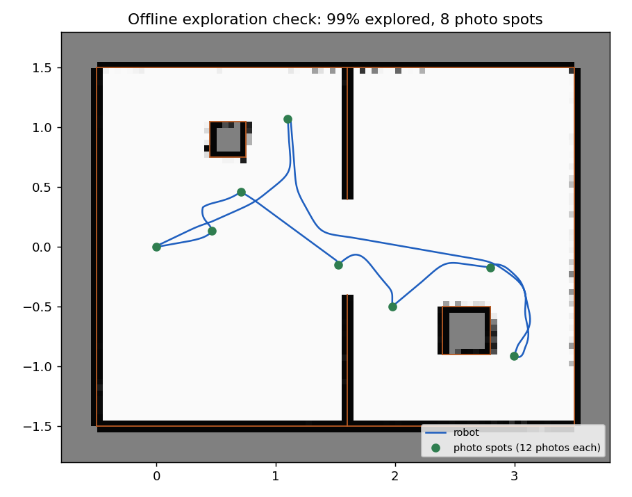

# Autonomous exploration and photo capture

The TurtleBot maps a room it does not know and takes the photos for the Lab 6 reconstruction by itself.



## How it works

```
/scan, /odom --> cartographer (or simple_mapper) --> /map + TF map -> odom
/map --> explorer: frontiers, Dijkstra on a costmap --> /tb_nmpc/path --> tb_nmpc (NMPC) --> /cmd_vel
explorer --> /auto_capture/capture --> auto_capture: photo + TF map -> base_link --> run_*/img_XXXX.png, poses.csv
```

1. **Spin.** The robot turns in place in 12 steps of 30°. At each step it stops, waits 0.6 s, and asks `auto_capture` for a photo. It turns again only once the photo is saved (`/auto_capture/saved`).
2. **Plan.** On the latest `/map`, frontiers are free cells next to unknown ones, grouped into clusters of at least 8 cells (0.4 m). Dijkstra runs on a costmap: obstacles plus 17 cm are forbidden, and the cost rises within 40 cm of an obstacle, so paths keep to the middle. The chosen frontier minimises path length − 0.5 × frontier length. Frontiers already visited are blacklisted.
3. **Drive.** The robot turns to face the path, then the NMPC follows it (`path_source:=topic`), still avoiding what the lidar sees, and publishes `/follow/done` at the end.
4. Back to 1. With no reachable frontier left on three maps in a row, the robot drives back to its start and stops.

[`auto_capture`](../src/tb_explore/tb_explore/auto_capture.py) writes the same folder as `lab6_capture/capture_pose.py`: `run_YYYYmmdd_HHMMSS/img_0000.png …` and `poses.csv` with `file, image_stamp, tf_stamp, tf_source, x, y, z, qx, qy, qz, qw, yaw_deg`. The Lab 6 scripts read it unchanged.

## Checks

- Unit tests (`src/tb_explore/test`): frontier on a half-known room, costmap, plan to the frontier that never crosses an occupied cell, blacklist, path home, log-odds map.
- [`scripts/explore_offline.py`](../scripts/explore_offline.py): the planner and the NMPC in a simulated 4 m × 3 m room, with an inner wall (0.8 m door) and two boxes, a simulated lidar and the log-odds map. Result: 99 % of the room explored, 6 goals, 8 photo spots, back within 3 cm of the start, never closer than 9 cm to a wall, 292 s of robot time.
- Webots, same room (`world:=room.wbt`), the whole ROS stack with `mapper:=simple`: 3 goals, 4 spins, 46 photos with poses, back home, 205 s. Photos were taken at 30° steps to within 2°. One photo was lost at the very start, before the camera streamed; there is now one retry.
- Real robot, 2 November 2026 ([run](../results/explore_2026-11-02/README.md)): 2 goals, 36 photos with poses, back home in 257 s; Lab 6 bundle adjustment 0.30 px, but only 88 points. Fixed since: frontiers behind cartographer's uncertain band, and photos every 0.3 m while driving (`capture_spacing`).

## Run it on the robot (C106A lab)

On the TurtleBot (ssh), two sessions, as in Lab 4:

```bash
ros2 launch turtlebot3_bringup robot.launch.py
ros2 launch usb_cam usb_cam.launch.py
```

On the workstation, in `distrobox enter ros2` (after `git pull` and `colcon build --symlink-install` in `~/tb_ws`):

```bash
source ~/turtlebot-nmpc/scripts/env.sh
ros2 launch tb_explore explore.launch.py
ros2 service call /explorer/start std_srvs/srv/Trigger      # second terminal
ros2 service call /explorer/stop std_srvs/srv/Trigger       # to stop at any time (or Ctrl-C the launch)
```

On apple the camera topic is `/apple/image_raw`. Useful options: `max_speed:=0.10`, `max_time:=600`, `captures_per_spin:=8`, `image_topic:=/apple/image_raw` (if the camera is namespaced), `capture:=false`, `mapper:=simple` (if cartographer misbehaves), `rviz:=true`. The photos go to `~/explore_captures/run_<date>/`.

Watch in RViz: `/map`, `/explorer/frontiers` (blue points, orange goal), `/tb_nmpc/reference_path`, `/tb_nmpc/obstacles`.

## Reconstruct with Lab 6

```bash
cp -r ~/explore_captures/run_<date> <your lab6 folder>/captures/
cd <your lab6 folder>/reconstruction
python3 multiview.py ../captures/run_<date>
python3 bundle_adjust.py ../captures/run_<date>
python3 view_viser.py ../captures/run_<date>
```

It uses the camera calibration you made in Lab 6 (`calibration/calibration.json`). `multiview.py` matches every pair of photos, so 48 photos means 1128 pairs: start with `captures_per_spin:=8` or a short run.

## In Webots

```bash
bash scripts/sim.sh world:=room.wbt controller:=none scenario:=clear
ros2 launch tb_explore explore.launch.py mapper:=simple use_sim_time:=true cmd_vel_type:=stamped \
    image_topic:=/TurtleBot3Burger/camera/image_color autostart:=true
```
