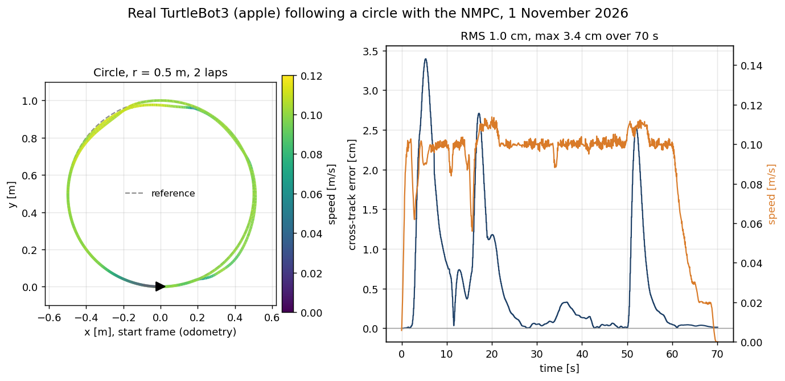

# Checks and reproduction

How the numbers in the [README](../README.md) were checked, and the command behind each result and figure.

## How I checked it

- 21 unit tests: 13 for perception, tracker and reference ([`tb_nmpc/test`](../src/tb_nmpc/test)), 8 for the explorer ([`tb_explore/test`](../src/tb_explore/test)).
- [`offline_check.py`](../scripts/offline_check.py): NMPC and tracker on a plain unicycle, no ROS. Over 5 runs each, minimum clearance 23.3 to 26.1 cm with prediction and -20.8 to -17.9 cm without, the same ordering as in Webots ([log](../results/offline_check_2026-11-03/README.md)).
- Tracker against the Webots ground truth, person at 0.5 m/s: 8 to 16 cm position and 0.06 to 0.11 m/s velocity error (median per run).
- Baselines: Nav2 Jazzy MPPI defaults and default inflation, one costmap for MPPI and RPP; only MPPI's goal-critic thresholds changed, 1.4 to 0.6 m ([`nav2_mppi.yaml`](../src/tb_nmpc/config/nav2_mppi.yaml)).
- The seven NMPC runs at 0.5 m/s: 2 benchmark runs, the video run and 4 repeats on 31 October ([repeats](../results/sim_2026-10-31_crossing_repeats/README.md)); 5 runs of an intermediate version with a clock bug are kept apart.
- Bugs that changed the numbers while I built it: [DEVELOPMENT_NOTES.md](DEVELOPMENT_NOTES.md).

## Simulation details

- MPPI has no target speed and drives at its cap: it laps fastest (45.7 s against 53.0 s) and cuts the lobes (8.6 cm tracking RMSE on the clear lap).
- At 1.0 m/s prediction reduces the contact depth (-8.5 against -20.5 cm worst case) but does not avoid contact.
- NMPC solve time: 0.79 to 0.91 ms median per run, worst 11.7 ms, on a 2016 laptop CPU (i7-6700HQ), against a 100 ms period.

Per-scenario figures: [`docs/figures/paths_*.png`](figures) (true paths) and [`clearance_*.png`](figures) (clearance over time).

## Lab robot details

TurtleBot3 Burger "apple" in the C106A lab, ROS 2 Humble, controller on the lab workstation, 0.12 m/s cap. Solve time 1.2 to 1.5 ms median, under 3 ms max. The runs with a box on the circle are not a valid comparison yet: both path setups had a bug ([run notes](../results/real_2026-11-01/README.md)).

## Commands

| Output | Command |
|---|---|
| `results/sim_2026-10-30/` (32 runs) | `bash scripts/run_benchmark.sh results/sim_2026-10-30` (about 80 min) |
| `summary.md` from existing logs | `python3 scripts/metrics.py results/sim_2026-10-30` |
| `docs/figures/paths_*.png`, `clearance_*.png` | `python3 scripts/plot_benchmark.py results/sim_2026-10-30 docs/figures` |
| real-robot circle table | `python3 scripts/metrics_real.py results/real_2026-11-01 --path-shape circle --path-size 0.5` |
| exploration animation | `python3 scripts/bag_animation.py <decompressed bag> docs/figures/real_exploration_run3.gif` |
| `docs/figures/overview.png` | hand-written `overview.svg`, rendered at 2x with headless Chrome |
