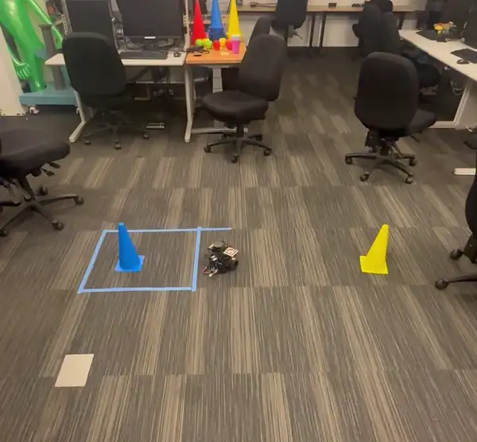
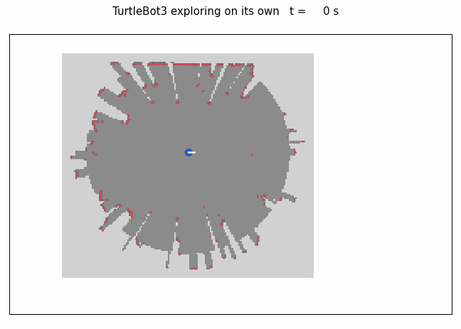

# Results

All numbers in the [README](../README.md), with their source files. Back to the [README](../README.md).

## Webots benchmark

Same caps for every controller (0.20 m/s, 2.0 rad/s), one lap of a 9.15 m figure eight per run, each in a fresh simulation. The simulated pedestrian is a 0.15 m-radius cylinder that crosses the path at constant speed and does not yield. Cells: runs with contact / runs, then closest approach in cm (edge to edge, ground truth; negative is contact).

| Scenario | NMPC + prediction | NMPC, no prediction | Nav2 MPPI | Nav2 RPP |
|---|---|---|---|---|
| Pedestrian crossing at 0.5 m/s | 1/7: -2.2 to +32.1, median +12.2 | 2/2: -9.2, -9.0 | 3/3: -21.8, -19.8, -18.2 | 2/2: -7.3, -7.3 |
| Pedestrian crossing at 1.0 m/s | 2/2: -8.5, -6.6 | 2/2: -20.5, -18.2 | 2/2: -25.0, -18.5 | 2/2: -15.7, -15.6 |
| Two static obstacles near the path | 0/2: +4.0, +10.2 | 0/2: +4.7, +4.7 | 1/2: -7.1, +5.5 | 2/2: -7.0, -7.0 |
| Clear lap: tracking RMSE (ground truth), lap time | 3.2 cm, 53.0 s | 3.2 cm, 52.9 s | 8.8 cm, 45.7 s | 2.1 cm, 64.3 s |

Sources: [sim_2026-10-30/summary.md](../results/sim_2026-10-30/summary.md) and [runs.csv](../results/sim_2026-10-30/runs.csv) (2 runs per cell), plus [sim_2026-10-31_crossing_repeats](../results/sim_2026-10-31_crossing_repeats/README.md) for the 0.5 m/s crossing: the 7 NMPC runs are the 2 benchmark runs, 1 recorded run ([sim_2026-10-30_video](../results/sim_2026-10-30_video/summary.md)) and 4 repeats with the final code ([nmpc_final](../results/sim_2026-10-31_crossing_repeats/nmpc_final/runs.csv)); the third MPPI run is in [mppi](../results/sim_2026-10-31_crossing_repeats/mppi/summary.md). Five runs of an intermediate version with a clock bug are kept apart ([nmpc_clock_bug](../results/sim_2026-10-31_crossing_repeats/nmpc_clock_bug/summary.md), contact in 3 of 5).

On the clear lap, tracking error in the odometry frame (what the controller sees) is 0.2 cm for both NMPC variants, 8.6 cm for MPPI and 2.1 cm for RPP; the ground-truth values above include the odometry drift.

At 1.0 m/s every controller is hit: the tracker needs three 5 Hz scans to trust a velocity, which leaves about one second at 0.20 m/s. Prediction still roughly halves the depth of contact (-8.5 against -20.5 cm). Per-scenario discussion and figures: [sim_2026-10-30/README.md](../results/sim_2026-10-30/README.md).

NMPC solve time (acados `time_tot`) on a 2016 laptop CPU (i7-6700HQ), against a 100 ms control period: about 1 ms median with the final code (1.03 ms over the 4 `nmpc_final` runs, 0.89 to 1.23 ms per run), 0.79 to 0.91 ms per run in the 30 October benchmark, worst 12.9 ms.

## Lab TurtleBot3

TurtleBot3 Burger, ROS 2 Humble, controller on the lab workstation, 0.12 m/s cap. No motion capture: errors are in the odometry frame. Source: [real_2026-11-01](../results/real_2026-11-01/README.md), [summary_real.md](../results/real_2026-11-01/summary_real.md).

| Run | Path | Tracking RMSE / max, odom [cm] |
|---|---|---|
| circle_clear_nmpc_1 | circle r = 0.5 m, 2 laps | 1.9 / 8.6 |
| circle_clear_nmpc_2 | circle r = 0.5 m, 2 laps | 1.0 / 3.4 |
| clear_nmpc_1 | figure eight a = 0.5 m | 6.1 / 11.2 |

*The lab TurtleBot3 on a figure eight with the same controller (phone video, 2.5x).*

Solve time 1.2 to 1.5 ms median, under 3 ms max, on the lab workstation. The runs with a box on the circle (NMPC and MPPI) are logged but are not a valid comparison: both path setups had a bug ([run notes](../results/real_2026-11-01/README.md)).

## Exploration

The same controller drives a frontier exploration with cartographer. Run 3 lasted 5 min 30 s, drove 13.9 m, mapped 13.2 m x 8.4 m and took 76 photos ([run 3](../results/explore_2026-11-02c/README.md), [method](EXPLORATION.md)).

## Other checks

Unit tests, the offline check without ROS, tracker accuracy against the Webots ground truth and the commands behind every table and figure: [REPRODUCING.md](REPRODUCING.md). Bugs that changed the numbers while building it: [DEVELOPMENT_NOTES.md](DEVELOPMENT_NOTES.md).
