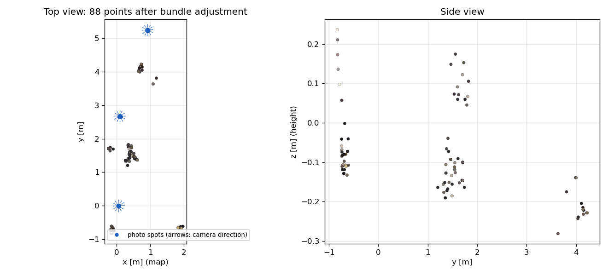

# Autonomous exploration on the real TurtleBot3, 2 November 2026

Lab TurtleBot3 "apple", C106A workstation (Humble), `ros2 launch tb_explore explore.launch.py max_speed:=0.10 max_time:=300 image_topic:=/apple/image_raw`, cartographer as in Lab 4.

## What happened

From [explore_log.txt](explore_log.txt) (the log lines of this run's own nodes: `explorer`, `tb_nmpc`, `auto_capture`):

- start spin (12 photos), goal 1 at 2.7 m (path 2.70 m), spin, goal 2 at 5.3 m (path 3.07 m), spin, then "no reachable frontier left", drive home, finished in 257 s.
- 36 photos, 640 x 480, all with the pose at the image time (`tf_source = image_stamp`), none blurred.
- The exploration stopped too early: cartographer leaves a band of cells that are neither free nor occupied between free and unknown space, and the frontier detection only looked for unknown (-1) cells next to free ones. Fixed after this run (`Grid.unexplored`, with a unit test).

## Reconstruction (Lab 6 code, team repository)

`multiview.py` then `bundle_adjust.py` on [run_20261102_153556](run_20261102_153556), with the team's calibration.

| | Points | Pairs with 20+ matches | RMS reprojection after BA | Camera shift from SLAM poses |
|---|---|---|---|---|
| Lab 6 code as is | 54 | 12 | 0.30 px | max 6 mm |
| without its `gray[:280,:] = 0` mask in `features.py` | 88 | 27 | 0.30 px | max 15 mm |

The mask blacks out the top 280 rows of each image, which is most of what a camera 10 cm above the floor sees. Without it: 1181 tracks, but only 88 points pass the 2° parallax check, because the 12 photos of a spin are taken from almost the same point (the camera is about 11 cm from the turning axis). The poses agree with the images (bundle adjustment moves the cameras by millimetres), but the cloud is too sparse to show the room: mostly chair legs between the photo spots.

Next run: photos every 0.3 m while driving (`capture_spacing`, added after this run) for parallax along the motion, the frontier fix for more photo spots, and `max_time:=900`.

Files: [reconstruction/ba.ply](reconstruction/ba.ply), [reconstruction/multiview.ply](reconstruction/multiview.ply) (open in MeshLab or CloudCompare). Figure: `python3 scripts/plot_reconstruction.py <lab6 dir> run_20261102_153556 docs/figures/real_reconstruction.png`.
