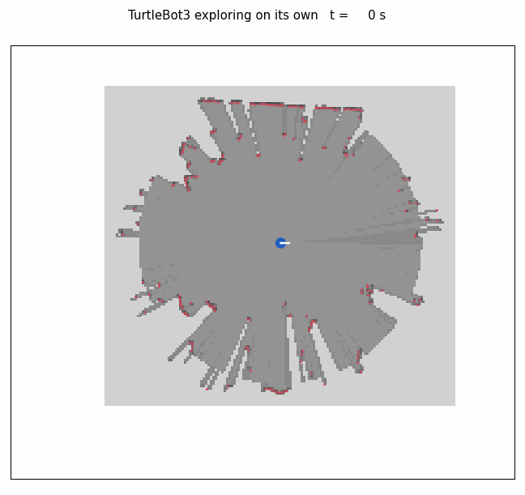

# Exploration run 2, 2 November 2026

Same setup as [run 1](../explore_2026-11-02/README.md), with `max_time:=900`, the frontier fix and the chair handling (`chair_radius` 0.32 m). Rosbag only: no photo was saved, the launch was started without `image_topic:=/apple/image_raw` (auto_capture now switches to the live image topic by itself). The run ended after 432 s when the battery ran low: the NMPC's watchdog stopped the robot ("odometry or lidar lost").

From [the bag](explore_20261102_b): a 10.8 m x 9.3 m map of the lab, 19.1 m driven, 5 frontier goals.

Animation: decompress the bag (`.db3.zstd`, zstd) and run `python3 scripts/bag_animation.py <bag dir> docs/figures/real_exploration.gif`.
