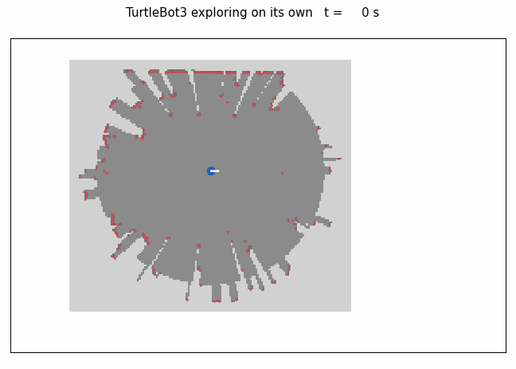
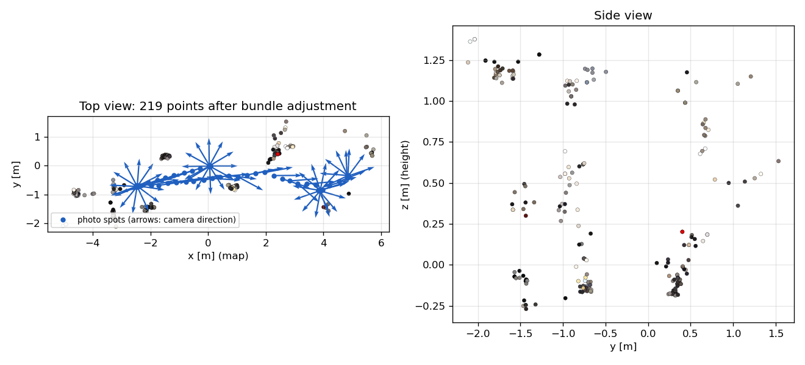
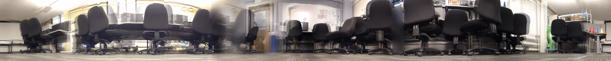

# Exploration run 3, 2 November 2026

Same setup as [run 2](../explore_2026-11-02b/README.md), with photos while driving (`capture_spacing` 0.3 m) and `image_topic:=/apple/image_raw`. Rosbag of 5 min 30 s.

| | Run 1 (spins only) | Run 3 (spins + while driving) |
|---|---|---|
| Photos | 36 | 76 (33 while driving) |
| Map | not saved | 13.2 m x 8.4 m |
| Driven | about 11 m | 13.9 m, 4 frontier goals |
| Reconstructed points (Lab 6 code, no top mask) | 88 | 219 |
| RMS reprojection after bundle adjustment | 0.30 px | 0.21 px |
| Largest camera shift from the SLAM poses | 15 mm | 39 mm |

The photos taken while driving give the parallax that the spins lack, and the point count went up 2.5 times. The cloud is still sparse: the Lab 6 method keeps only SIFT points matched in several views. 5 of the 76 photos are blurred (variance of the Laplacian under 40).

Files: [run_20261102_170423](run_20261102_170423) (photos and poses.csv in the Lab 6 format), [reconstruction/ba.ply](reconstruction/ba.ply), [explore_20261102_c](explore_20261102_c) (zstd-compressed bag). Animation: `python3 scripts/bag_animation.py <decompressed bag> docs/figures/real_exploration_run3.gif`.

## 360° panoramas

`scripts/spin_panorama.py` stitches each in-place spin with the robot's yaw from cartographer, with no feature matching. Each ray is placed at the distance the lidar map gives in that direction, which lines up nearby chairs despite the camera sitting 11.5 cm off the rotation axis. Three spins give a full panorama (12 or 13 photos); the fourth has 8 photos and covers 64 %. The blurred figures are people walking during the spin. Map and path for the viewer: `scripts/bag_map.py <decompressed bag> map.npz`.

## Dense reconstruction (not usable)

COLMAP 4 patch-match stereo with the robot poses fixed (`scripts/colmap_dense.sh`, one GPU, about 7 min) fuses 4578 points (photometric) and 1043 (geometric). They spread along the viewing rays and show no room shape. The spins give about 6 cm of baseline and the photos taken while driving look along the motion, so depth is poorly constrained. Output kept in [reconstruction/dense](reconstruction/dense). Extruding the lidar walls and texturing them with the photos (`scripts/textured_map.py`) was also tried; in this room the lidar slice is mostly chair and desk legs, and the result is not readable.
